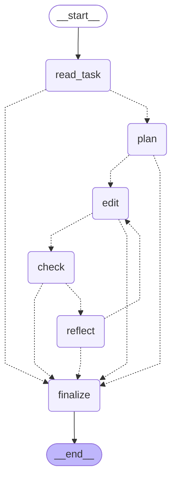

# CVDP RTL Agent

A LangGraph agent for NVIDIA's [CVDP benchmark](https://github.com/NVlabs/cvdp_benchmark) of hardware design
problems. It writes and fixes SystemVerilog, **checks its own work in simulation before it submits** (Icarus,
Verilator and cocotb), and records what every problem cost. Results are reported as pass rate, **cost per solved
problem** and wall time, by category, against a null agent and against published leaderboard rows.

**Status:** milestone 1 in review: the agent image, the sweep workflow and a 10-problem live check
([`docs/reports/M1_report.md`](docs/reports/M1_report.md)). On 10 seeded problems from the agentic split,
`anthropic/claude-haiku-5.5` passed 6/10 (Wilson 95% [31, 83]%) for $0.117 in all, and the open-weights
`deepseek/deepseek-v4.1-flash-1017` 5/10 ([24, 76]%) for $0.270; ten problems cannot separate the two. The null
agent passes none. Milestone 0 done (22 October 2026).

**M2a** (in review, [`docs/reports/M2a_report.md`](docs/reports/M2a_report.md)): reasoning limits, a retry on empty
replies and unreadable decisions, and seeds. On the same 10 problems on Arm64, DeepSeek at `reasoning=off` passed
6/10 for $0.0867 with no empty replies; at `low` it passed 7/10 for $0.3546 with 14 empty replies.

| M0 check | x86-64 (`ubuntu-24.04`) | Arm64 (`ubuntu-24.04-arm`) |
|---|---|---|
| Golden: harness example problems with their solutions | 1/1 | 1/1 |
| Null agent, agentic split (92) | 0/92 | 0/92 |
| Null agent, heavy split (75) | 0/75 | not run |
| Whole job, including building the simulation image | 23 min | 18 min |

Runs: [39847610657](https://github.com/BrendanJamesLynskey/CVDP_RTL_Agent/actions/runs/39847610657),
[39851112062](https://github.com/BrendanJamesLynskey/CVDP_RTL_Agent/actions/runs/39851112062) (Arm64),
[39851116748](https://github.com/BrendanJamesLynskey/CVDP_RTL_Agent/actions/runs/39851116748) (heavy). No problem
passes without edits, so every pass an agent gets is its own.

## What it is tested on

The free (open-source tools only) agentic splits of CVDP 1.1.0, frozen by hash:

| File | SHA-256 (first 16) | Problems | By category |
|---|---|---|---|
| `agentic_code_generation_no_commercial` | `2007f4311ed731a9` | 92 | spec to RTL (cid003) 34; RTL modification (cid004) 25; spec to RTL with module reuse (cid005) 22; bug fixing (cid016) 11 |
| `agentic_heavy_code_generation_no_commercial` | `809916fa3248a4b2` | 75 | cid003 6; cid004 6; cid005 7; bug fixing in large real repositories (cid016) 56 |

The verification-writing categories (testbench stimulus, checkers and assertions; cid012–014) are all in the
commercial split, which needs Cadence Xcelium. Two things stand in for them:

- **The agent's own check-before-submit loop.** Whether it pays for itself is the main ablation.
- **An open verification track on AMBA IP (M5).** Permissively licensed AXI4-Lite, AXI-Stream and APB blocks with
  seeded bugs. The agent writes a test plan, a cocotb testbench with functional coverage, and SVA properties
  checked formally with SymbiYosys. It is scored by how many seeded bugs it catches (mutant kill rate) and by false
  alarms on the clean RTL, never by its own report.

**AMBA slice.** 20 of the free problems have an AMBA interface (AXI4, AXI4-Lite, AXI-Stream, APB, AHB) on the
design being changed: 8 in the agentic split, mostly spec-to-RTL, and 12 in the heavy split, mostly bug fixing in
real repositories (verilog-axi, verilog-ethernet, axis). The list, and how it was made, is in
[`tools/amba_ids.txt`](tools/amba_ids.txt). Results are reported for this slice on its own as well as overall.

**Arm64.** Every workflow runs on GitHub's Arm64 runners as well as x86-64, and the sweep tables give wall time on
both.

## Rules

- The LLM never produces a score. Every number comes from the CVDP harness's hidden tests or from provider-reported
  token usage.
- Results only from real runs, with model IDs, tokens and cost; losses to a baseline are shown first.
- The harness and dataset are pinned (commit and revision in
  [`.github/workflows/m0_harness.yml`](.github/workflows/m0_harness.yml)).

## The agent

A LangGraph graph (`agent/cvdp_agent/`), run by the harness as a Docker image built on the harness's own
simulation image (Icarus 13, Verilator 5.038, Yosys 0.40, cocotb 2.0.1):

<!-- graph:begin -->

<!-- graph:end -->

- **read_task** reads `/code/prompt.json`, lists the files and detects the tools.
- **plan**: the LLM returns a JSON plan (files to change, approach, how it will check the result).
- **edit**: the LLM returns whole files or unified diffs. The file tool writes only under `rtl/`, `verif/` and
  `docs/` (and a scratch testbench under `rundir/agent_tb/`, never submitted); any other path is refused in code.
- **check**: deterministic tools the LLM picks from: `iverilog -g2012` compile (always), `verilator --lint-only
  -Wall`, a Yosys read/synth check, and its own SystemVerilog or cocotb testbench. Output is cut down in code
  before the LLM sees it.
- **reflect**: the LLM decides `edit_again`, `submit` or `give_up`. A reply that cannot be read as a decision is
  retried once, asking for the JSON decision only; if that cannot be read either, the agent submits.
- **Reasoning and empty replies**: every call sends OpenRouter's `reasoning` field at the `CVDP_REASONING` level
  (`{effort, exclude: true}`; nothing for `default`), and the trace keeps the `reasoning_tokens` and the serving
  `provider` OpenRouter reports. Reasoning counts against `max_tokens`, so a call that may reason gets headroom on
  top of the answer's cap (low 8,000, medium 16,000, high 24,000, default 16,000 tokens). A model that refuses the
  field gets it once, then the problem goes on at `default` (a refused lower level on a retry only sends that retry
  at the problem's own level). A reply that is empty (or only tool-call markup, DeepSeek's DSML tags included) is
  retried once, reasoning one step lower (high → medium → low → off;
  default → low) with a line asking for the answer only; both calls are traced and costed, linked by `retry_of`.
  If the retry is empty too, the turn is used as before. `summary.json` counts `empty_replies`, `empty_retries`
  and `reflect_parse_retries`.
- **Stop rules**, checked in code before every step: turn cap, per-problem budget in USD (provider-reported cost
  only), a call whose cost was not reported (`cost_unreported`: the budget can no longer be enforced), and wall
  time (480 s, under the harness's 600 s agent timeout). Every LLM call has a hard deadline 2 s before the wall
  cap: it runs in a worker thread and is abandoned there (counted as cost unreported); its `max_tokens` is cut to
  what the model can produce in the time left at the throughput seen so far, and it gets no client retry with
  under 60 s left. Each check's timeout is cut to the time left, and finalize has its own 30 s: about 510 s at
  worst. On any stop, and on a crash, the best edit is kept (the last one that compiled), the summary
  and ledger entry are written, and the agent exits 0. Both are also written before every LLM call (with the call
  counted as unreported) and after it (as `killed`), so a problem the harness kills keeps its cost.
- **Tools run without secrets**: checks get an environment with every credential-like variable removed, and in the
  image they run as an unprivileged user (`cvdptool`), so model-written testbench code cannot read the key from its
  own environment or from the agent's through `/proc`.
- **Outputs** per problem in `rundir/agent_out/` (the harness keeps it in the work directory): `trace.jsonl`, every
  LLM call (node, model, tokens, cost, latency, decision) and tool call (command, exit code, truncated output), with
  anything key-shaped redacted; `summary.json`, the totals, stop reason and switches.

| Variable | Default | |
|---|---|---|
| `CVDP_PROVIDER` | `openrouter` | `openrouter`, or `fake` (scripted, deterministic; tests and the PR smoke run) |
| `CVDP_MODEL` | | OpenRouter model ID |
| `CVDP_MAX_TURNS` | 10 | edit, check, reflect cycles |
| `CVDP_BUDGET_USD` | 0.10 | per problem |
| `CVDP_SELF_CHECK` | 1 | 0 skips the self-written testbench |
| `CVDP_LINT` | 1 | 0 skips the Verilator lint and Yosys checks |
| `CVDP_WALL_S` | 480 | wall-time cap, seconds |
| `CVDP_REASONING` | `default` (the sweep sends `low`) | `default`, `low`, `medium`, `high` or `off` (OpenRouter's `reasoning.effort`; `off` is `none`) |
| `CVDP_SEED` | | the sweep's repeat number; a label in the trace and summary only (sampling is not seeded) |
| `CVDP_PROVIDER_ORDER` | | OpenRouter providers, comma-separated, used in that order with no fallbacks |

## Running a sweep

From the Actions tab, **Sweep → Run workflow**, or `gh workflow run sweep.yml -f model=anthropic/claude-haiku-5.5
-f ids=$(grep -v '^#' tools/m1_ids.txt | paste -sd,)`. Inputs: model, split, ids (blank = all), per-problem
budget, turn cap, self-check and lint switches, threads, runner (x86-64 or Arm64), an optional absolute
whole-run budget, `reasoning` (default `low`), `seeds` (default 1) and `provider_order` (blank: OpenRouter
routes each call; the provider that served it is in the trace, and its price can differ from the list price).
Tables and `results.csv` label each row with the model and its reasoning setting, e.g.
`deepseek/deepseek-v4.1-flash-1017 (reasoning off)`.

**Seeds** repeat the same problem list: each seed gets its own work directory (`work/seed<n>/`) and its own harness
invocation, run one after another in the same job, with `CVDP_SEED=<n>` passed to the agent. One ledger is shared,
so the spend guard covers the whole job across seeds. `results.csv` has a `seed` column, and with more than one
seed the table starts with mean pass@1 across seeds with its min–max range, pooled pass@1 with a 95% interval from
a bootstrap over problems (each problem's seeds kept together), and the cost per solved problem pooled across
seeds (`tools/table.py --seeds`). A seed starts only if the Run step has time left for its worst case
(ceil(problems / threads) × 660 s + 300 s), because a seed cut off by the step timeout loses every problem it
finished; a seed not started is listed in the table. Each seed's UTC start and end are in `work.run.json` and the
table.

The job pulls both images from GHCR, runs the harness (with its own step timeout), then collects,
writes the table and the key's usage before and after the run to the job summary, scans the work directory for
anything key-shaped, and uploads it only if the scan passes (per-test logs, `raw_result.json`, every `agent_out/`).
The key reaches the agent only through `CVDP_AGENT_ENV`. A whole-run guard stops new problems from calling the LLM
once the summed cost (with the per-problem budget charged for every call whose cost was not reported) passes
`run_budget_usd`, or budget × problems × seeds × 1.2 when that is blank ($11.04 for all 92, one seed).

Locally, with the harness in `cvdp/`, the dataset in `data/` and both images in Docker:
`AGENT_IMAGE=... MODEL=... IDS=... REASONING=low SEEDS=1 WORK=<new dir> bash tools/sweep.sh`. It refuses a work directory that is not
empty (an old ledger and the harness's reuse of `raw_result.json` would make the rerun wrong).

## Layout

- [`agent/`](agent/): the agent (`cvdp_agent`, Python 3.12, LangGraph) and its pinned requirements.
- [`docker/agent.Dockerfile`](docker/agent.Dockerfile): the agent image, on top of the simulation image.
- [`.github/workflows/images.yml`](.github/workflows/images.yml): builds `ghcr.io/brendanjameslynskey/cvdp-sim:8e894cf`
  (once) and `ghcr.io/brendanjameslynskey/cvdp-rtl-agent:<sha>`, both linux/amd64 and linux/arm64, each arch on its
  own native runner.
- [`.github/workflows/sweep.yml`](.github/workflows/sweep.yml): a sweep (dispatch), or the smoke run with the fake
  provider on 2 problems (pull requests).
- [`.github/workflows/tests.yml`](.github/workflows/tests.yml): `pytest tests/` on every push and pull request.
- [`.github/workflows/m0_harness.yml`](.github/workflows/m0_harness.yml): M0. Checks the harness's example problems
  score 100% with their solutions, and runs the null agent; pulls the simulation image from GHCR (or builds it with
  `build_sim`).
- [`agents/null/Dockerfile`](agents/null/Dockerfile): the null agent (changes nothing), the floor.
- [`tools/`](tools/): `collect.py` (raw_result.json + summary.json → one CSV row per problem), `table.py` (pass@1
  with a Wilson 95% interval, $/problem, $/solved problem, median wall time, by category and AMBA slice),
  `sweep.sh`, `subset.py`, `effort_probe.py` (reasoning tokens per `CVDP_REASONING` level on one small prompt),
  `log_check.py` (classifies per-test logs: tests failed, build failed or harness error), `key_usage.py` (the key's `usage` only), `models.py` (whether OpenRouter model IDs exist, their prices, context and `reasoning` support, from the public model list), `pick_ids.py` (the seeded M1 sample, `m1_ids.txt`), `amba_scan.py` and `amba_ids.txt`,
  `inventory.py`.
- [`tests/`](tests/): the graph with the fake provider (stop rules, path refusal, budget, best edit kept, switches),
  trace redaction, the results tools on a fixture, and the README graph drift test.
- [`docs/reports/`](docs/reports/): milestone reports.

## Milestones

| | Work |
|---|---|
| M0 | Harness in CI; golden check; null-agent floor; frozen problem list |
| M1 | The agent image: plan, edit, simulate and lint, reflect, with a per-problem budget |
| M2 | Sweep the free agentic split with two cheap models and one open-weights model |
| M3 | Ablations: self-check on and off, lint on and off, turn and budget caps; failure taxonomy |
| M4 | Write-up, logs packed for the Si2 LBC-bench leaderboard |
| M5 | Open AMBA verification track: test plan, cocotb testbench with coverage, SVA with SymbiYosys; scored by seeded-bug kill rate and false alarms |

## Licence

MIT. The CVDP harness is Apache-2.0 and the dataset CC BY 4.0 / Apache-2.0; neither is redistributed here, both
are fetched at run time.
