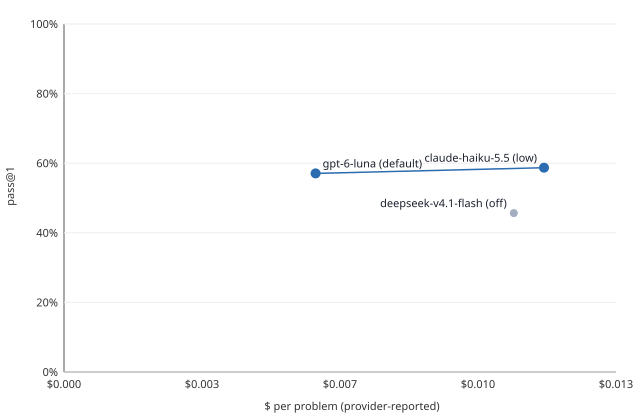

# M3 report: ablations and failure taxonomy (skeleton)

23 October 2026. Branch `m3-ablations-taxonomy`. The tools and their tests are done. **The arms' numbers are not:**
the planner is running the seven arms (gpt-6-luna, reasoning `default`, all 92 problems, Arm64, 4 threads, 2 runs
each). Every table below is produced by `tools/ablate.py` or `tools/taxonomy.py` from data already in the repo.
Each table that waits on the arms is marked **[waits on arms]**. The rules from the M1 report still apply: the LLM
never produces a score or a label, and every cost is provider-reported.

## In short

Negative and null findings first:

- **The noise floor, from M2: same settings, different runner (a conservative floor).** M2's two gpt-6-luna runs
  had the same image, problems and settings, but one ran on Arm64 (39981444074) and one on x86 (39967317698). They
  give **no detectable effect: −1.1 points [−7.6, +5.4]**, with 4 problems better, 5 worse and 83 the same (sign
  test p = 1). With one run per side, an arm has to move the pass rate by more than about ±7 points on 92
  problems before it shows. All M3 arms run on Arm64 with 2 runs each, and a problem's rate is averaged over the
  runs, so their floor should be narrower: about ±5 if run-to-run noise is what sets the width (±7/√2). That
  figure is an expectation, not a measurement. Arm A's two runs will measure it.
- **Haiku against Luna (M2, as a worked example): no detectable effect**, +1.6 points [−4.9, +8.2], 12 better and
  12 worse. DeepSeek is worse than Luna: −11.4 [−20.1, −2.7], 6 better and 21 worse, p = 0.0059.
- **The arms (B–G against A): [waits on arms].**
- **The taxonomy on M2's CSVs labels only 30 of 255 failures.** M2's CSVs carry no log or trace evidence: 24 are
  `stopped_by_cap`, 6 `gave_up` and 225 `needs_artifacts`. `collect.py` now writes the evidence, so every M3 run's
  `results.csv` carries a label for each failure. The labels for the M2 failures need their artifacts, which this
  session cannot download.

## Arms and settings

All arms use `openai/gpt-6-luna`, reasoning `default`, the 92 agentic problems, `ubuntu-24.04-arm` and 4 threads.

| Arm | Change from M2 | Runs | Run IDs |
|---|---|---|---|
| A base | none (10 turns, $0.10, self-check on, lint on) | 2 | 39981444074 (M2) + **[waits on arms]** |
| B | `self_check=false` | 2 | **[waits on arms]** |
| C | `lint=false` | 2 | **[waits on arms]** |
| D | both off | 2 | **[waits on arms]** |
| E | `max_turns=5` | 2 | **[waits on arms]** |
| F | `max_turns=20` | 2 | **[waits on arms]** |
| G | `budget_usd=0.02` | 2 | **[waits on arms]** |

A second dispatch of an arm should set `seed_offset=1`, so its seed is 2. `ablate.py` keeps runs apart by
(CSV file, seed) either way.

## Paired results

**[waits on arms]** The tables are produced by:

```
python3 tools/ablate.py --base A \
  --arm A=a1/work/results.csv,a2/work/results.csv --arm B=b1/work/results.csv,b2/work/results.csv  ...  \
  --pareto-csv docs/reports/m3/pareto.csv --pareto-svg docs/reports/m3/pareto.svg
```

Without `--arm`, the CSVs are grouped by label plus the settings that differ from M2 (for example
`openai/gpt-6-luna (reasoning default) self_check=0`), and the arm with M2's settings is the base.

**Calibration: same settings, different runner** (M2's two Luna runs, Arm64 against x86; a conservative floor;
`calibration_same_config.md`):

| Arm | Finding | Effect [95%] | Better / worse / same | Sign test p | Problems | Dropped |
|---|---|---|---|---|---|---|
| luna default, x86 run (39967317698) | no detectable effect | -1.1 [-7.6, +5.4] | 4 / 5 / 83 | 1 | 92 | 0 |

**Worked example on M2's three models** (each pooled over its x86 and Arm64 runs; `m2_models_paired.md`):

| Arm | Finding | Effect [95%] | Better / worse / same | Sign test p | Problems | Dropped |
|---|---|---|---|---|---|---|
| claude-haiku-5.5 (low) | no detectable effect | +1.6 [-4.9, +8.2] | 12 / 12 / 68 | 1 | 92 | 0 |
| deepseek-v4.1-flash (off) | worse than base | -11.4 [-20.1, -2.7] | 6 / 21 / 65 | 0.00592 | 92 | 0 |

No problem is dropped from either paired effect: all three models ran all 92.

| Arm | Runs: pass rate each | Pooled pass@1 [95% problem bootstrap] | Cost | $/problem | $/solved | Median wall | Tokens |
|---|---|---|---|---|---|---|---|
| gpt-6-luna (default) (base) | 2: 57.6%, 56.5% | 105/184 = 57.1% [46.7, 66.8] | $1.1231 | $0.0061 | $0.0107 | 72 s | 5,429,392 |
| claude-haiku-5.5 (low) | 2: 60.9%, 56.5% | 108/184 = 58.7% [49.5, 67.4] | $2.1423 | $0.0116 | $0.0198 | 45 s | 11,272,864 |
| deepseek-v4.1-flash (off) | 2: 44.6%, 46.7% | 84/184 = 45.7% [35.9, 54.9] | $2.0077 | $0.0109 | $0.0239 | 31 s | 10,345,544 |

## The Pareto chart

**[waits on arms]** For now, M2's three models. Pass rate is pooled over both runs; $ per problem is
provider-reported.



| Arm | $/problem | Pass rate | Frontier |
|---|---|---|---|
| gpt-6-luna (default) | $0.0061 | 57.1% | yes |
| deepseek-v4.1-flash (off) | $0.0109 | 45.7% |  |
| claude-haiku-5.5 (low) | $0.0116 | 58.7% | yes |

CSV: [`m3/pareto_m2_models.csv`](m3/pareto_m2_models.csv). The SVG is written by `ablate.py` itself, with no
external service.

## The taxonomy

One primary label per failed (problem, run). Every failed row gets a real label: `unclassified` (evidence present,
no rule holds) is reachable only as a gap in the rules, and a test asserts it never fires on the fixtures. The label
is the first rule that holds, in this order: `llm_error`,
`agent_error`, `killed`, `no_edit`, `stopped_by_cap`, `gave_up`, `sim_incomplete`, `compile_fail_own`,
`compile_fail_hidden`, `tests_failed_selfcheck_passed`, `tests_failed_selfcheck_failed`,
`tests_failed_no_selfcheck`, `harness_error`. Every other rule that holds becomes a secondary flag, and so do
`partial_pass`, `single_turn`, `self_check_off`, `lint_off`, `empty_replies` and `best_edit_restored`.

The evidence:
- **The harness's per-test log**, classified by `log_check.py`: `tests_failed`, `build_failed`, `sim_incomplete`
  or `harness_error`. `sim_incomplete` is new: pytest started a simulation, or had collected its tests and was
  capturing their output, and the log ends with no pytest summary (a hang or a kill). M2 counted these as
  `harness_error`.
  - On a harness kill, `raw_result.json` has `"log": null` and an `error_msg`. The problem's own log is then read
    from `reports/<n>.txt`, where n is the problem number without leading zeros.
  - A failed problem with no log to read, or with no tests recorded, is `harness_error` (flagged `no_log` or
    `no_tests`).
- **The agent's trace**: its last compile, and its last own testbench result. When finalize restored the best
  compiled edit (`kept` = `best_compiled_turn_N`), the submitted code compiled, so its own compile counts as passed
  even though `final_compiled` describes the discarded edit.
- **The summary**: the stop reason, and the files changed under `rtl/`. `run_budget_exhausted` (the whole-run
  guard stopped the problem before its first call) counts as `stopped_by_cap`. `no_task` counts as `agent_error`.
  Neither counts as `no_edit`, because the agent never reached an edit.

Changes to the brief's list, from what M2 shows:
- `gave_up` is added: Haiku gave up 1–4 times per sweep.
- `agent_error` and `killed` are added, for a crash and for a problem with no final summary.
- `tests_failed_selfcheck_failed` is added: the agent's own testbench failed and it submitted anyway. The brief's
  two self-check labels did not cover that case.

### By arm and by cid: M2's committed CSVs (stop-reason evidence only)

**[waits on arms]** for M3. These are the six M2 full runs:

| Label | claude-haiku-5.5 (low) | deepseek-v4.1-flash (off) | gpt-6-luna (default) | All |
|---|---|---|---|---|
| stopped_by_cap | 0 | 17 | 7 | 24 |
| gave_up | 5 | 1 | 0 | 6 |
| needs_artifacts | 71 | 82 | 72 | 225 |
| **All failures** | 76 | 100 | 79 | 255 |

By cid:

| Label | cid003 | cid004 | cid005 | cid016 | All |
|---|---|---|---|---|---|
| stopped_by_cap | 8 | 11 | 3 | 2 | 24 |
| gave_up | 1 | 3 | 0 | 2 | 6 |
| needs_artifacts | 78 | 59 | 65 | 23 | 225 |
| **All failures** | 87 | 73 | 68 | 27 | 255 |

Secondary flags: single_turn 83, partial_pass 3, best_edit_restored 3, empty_replies 1

### The 28 problems no M2 run solved

**[waits on artifacts]** for their real labels. From the CSVs alone:

| Problem | cid | Labels across the runs here |
|---|---|---|
| `DES_0001` | cid003 | needs_artifacts ×5, stopped_by_cap ×1 |
| `arithmetic_progression_generator_0001` | cid016 | needs_artifacts ×6 |
| `binary_search_tree_algorithms_0001` | cid004 | needs_artifacts ×5, gave_up ×1 |
| `binary_search_tree_algorithms_0014` | cid005 | needs_artifacts ×6 |
| `csr_using_apb_interface_0001` | cid003 | needs_artifacts ×6 |
| `digital_stopwatch_0001` | cid005 | needs_artifacts ×6 |
| `dynamic_equalizer_0001` | cid003 | needs_artifacts ×6 |
| `dynamic_equalizer_0008` | cid005 | needs_artifacts ×6 |
| `elevator_control_0004` | cid004 | needs_artifacts ×5, stopped_by_cap ×1 |
| `hdbn_codec_0001` | cid005 | needs_artifacts ×6 |
| `jpeg_runlength_enc_0001` | cid005 | needs_artifacts ×6 |
| `lfsr_0005` | cid016 | needs_artifacts ×5, gave_up ×1 |
| `nmea_gps_0008` | cid004 | needs_artifacts ×3, stopped_by_cap ×2, gave_up ×1 |
| `phase_rotation_0010` | cid005 | needs_artifacts ×6 |
| `phase_rotation_0015` | cid004 | needs_artifacts ×5, stopped_by_cap ×1 |
| `phase_rotation_0028` | cid005 | needs_artifacts ×6 |
| `phase_rotation_0031` | cid004 | needs_artifacts ×6 |
| `phase_rotation_0038` | cid003 | needs_artifacts ×4, gave_up ×1, stopped_by_cap ×1 |
| `poly_decimator_0001` | cid005 | needs_artifacts ×5, stopped_by_cap ×1 |
| `queue_0001` | cid003 | needs_artifacts ×6 |
| `rc5_0001` | cid003 | needs_artifacts ×6 |
| `secure_apb_history_shift_register_0001` | cid004 | needs_artifacts ×5, stopped_by_cap ×1 |
| `sigma_delta_audio_0001` | cid003 | needs_artifacts ×6 |
| `spi_complex_mult_0002` | cid003 | needs_artifacts ×5, stopped_by_cap ×1 |
| `sync_serial_communication_0001` | cid003 | needs_artifacts ×5, stopped_by_cap ×1 |
| `thermostat_secure_0001` | cid004 | needs_artifacts ×6 |
| `traffic_light_controller_0001` | cid004 | needs_artifacts ×6 |
| `ttc_lite_0001` | cid003 | needs_artifacts ×6 |

### Evidence excerpts

**[waits on artifacts]** The real excerpts are 3 per label, from the M3 arms, each at most 10 lines of log and
trace, redacted (`taxonomy.py --work NAME=dir --excerpts`). For now, the fixture's, one per label, are in
[`m3/taxonomy_fixtures.md`](m3/taxonomy_fixtures.md). Two of them:

**sim_incomplete**: `cvdp_agentic_tax_sim_incomplete_0001` (fixture#seed1)
```
log:    200.00ns INFO     cocotb.fifo                        writing 64 words
log:    850.00ns INFO     cocotb.fifo                        waiting for full flag
trace: llm edit decision={"changed": ["rtl/dut.sv"], "errors": 0, "checks": ["compile", "testbench"]}
trace: compile exit=0 iverilog -g2012 -o rundir/agent_tb/compile.vvp rtl/dut.sv
trace: testbench_run exit=0 vvp -n tb.vvp
```

**compile_fail_hidden**: `cvdp_agentic_tax_compile_fail_hidden_0001` (fixture#seed1)
```
log: E   subprocess.CalledProcessError: Command '['iverilog', '-g2012', '-o', 'sim.vvp', '-s', 'axis_to_uart_tx']' returned non-zero exit status 1.
log: error: Unable to find the root module "axis_to_uart_tx" in the Verilog source.
log: ============================== 1 failed in 0.52s ===============================
trace: llm edit decision={"changed": ["rtl/dut.sv"], "errors": 0, "checks": ["compile", "testbench"]}
trace: compile exit=0 iverilog -g2012 -o rundir/agent_tb/compile.vvp rtl/dut.sv
trace: testbench_run exit=0 vvp -n tb.vvp
```

### Rules against hand labels

**[waits on artifacts]** for real failures. The 15 below are fixture failures (`tests/fixtures/taxonomy/`). The
four fixtures added in review round 1 (harness kill with and without a log, a restored best edit, no tests) are
rule tests and are not in the hand set. Their hand labels were written from each case's log and trace. The same author wrote
the fixtures and the rules, so this checks the code, not the rules' judgement on real failures.
`taxonomy.py --sheet sheet.csv --sample 15` draws 15 real failures for hand-labelling, and `--hand sheet.csv`
scores them.

**Hand labels against the rules: 14/15 agree (93%)**

| Problem | Run | Hand | Rules |
|---|---|---|---|
| `cvdp_agentic_tax_agent_error_0001` | fixture#seed1 | agent_error | agent_error |
| `cvdp_agentic_tax_ambiguous_cap_mismatch_0001` | fixture#seed1 | compile_fail_hidden | stopped_by_cap ✗ |
| `cvdp_agentic_tax_compile_fail_hidden_0001` | fixture#seed1 | compile_fail_hidden | compile_fail_hidden |
| `cvdp_agentic_tax_compile_fail_own_0001` | fixture#seed1 | compile_fail_own | compile_fail_own |
| `cvdp_agentic_tax_gave_up_0001` | fixture#seed1 | gave_up | gave_up |
| `cvdp_agentic_tax_harness_error_0001` | fixture#seed1 | harness_error | harness_error |
| `cvdp_agentic_tax_killed_0001` | fixture#seed1 | killed | killed |
| `cvdp_agentic_tax_llm_error_0001` | fixture#seed1 | llm_error | llm_error |
| `cvdp_agentic_tax_no_edit_0001` | fixture#seed1 | no_edit | no_edit |
| `cvdp_agentic_tax_partial_selfcheck_passed_0001` | fixture#seed1 | tests_failed_selfcheck_passed | tests_failed_selfcheck_passed |
| `cvdp_agentic_tax_sim_incomplete_0001` | fixture#seed1 | sim_incomplete | sim_incomplete |
| `cvdp_agentic_tax_stopped_by_cap_0001` | fixture#seed1 | stopped_by_cap | stopped_by_cap |
| `cvdp_agentic_tax_tests_failed_no_selfcheck_0001` | fixture#seed1 | tests_failed_no_selfcheck | tests_failed_no_selfcheck |
| `cvdp_agentic_tax_tests_failed_selfcheck_failed_0001` | fixture#seed1 | tests_failed_selfcheck_failed | tests_failed_selfcheck_failed |
| `cvdp_agentic_tax_tests_failed_selfcheck_passed_0001` | fixture#seed1 | tests_failed_selfcheck_passed | tests_failed_selfcheck_passed |

The one disagreement is a design choice the real data should settle. A run stopped by the wall cap whose hidden
build failed on a missing module is `stopped_by_cap`, with `compile_fail_hidden` as a flag; by hand, the interface
mismatch is the real failure. If real runs show many of these, `compile_fail_hidden` should move ahead of
`stopped_by_cap`.

## What the failures say for M5 and M4

**[waits on arms and artifacts]** The questions the labels are built to answer:

- **For M5 (verification):** how often the agent's own testbench passed while the hidden tests failed
  (`tests_failed_selfcheck_passed`), against arm B's change in pass rate with self-check off. A self-check that
  rarely catches a bug it later fails on is the case for M5's coverage and assertion work.
- **For M5:** `compile_fail_hidden` counts interface mismatches with the hidden testbench, which a port and
  parameter check against the specification would catch before submitting.
- **For M4 (write-up):** the turn-cap and budget arms (E, F, G) against `stopped_by_cap`. If F (20 turns) gains
  nothing and E (5 turns) loses nothing, the cap is not what limits the agent.
- **For M4:** what is comparable to published rows. The published rows are for full CVDP with commercial tools,
  so M4 reports the free split on its own terms, with the M2 noise floor beside every comparison.

## Known gaps

- **No arm has been run with these tools**, and this session cannot reach the artifact store (403 at the proxy),
  so the M2 traces and logs were not read. Every table here comes from committed CSVs and the fixtures.
- **M2's CSVs have no evidence columns**, so 225 of their 255 failures are `needs_artifacts`.
  `taxonomy.py --work NAME=<artifact>/work` labels them from the artifact. From M3 on, `collect.py` writes the
  labels as each sweep runs.
- **The base's first run (39981444074) ran before the new `collect.py`.** Use its artifact with `--work`, or
  re-run `collect.py` on it, to give it labels. Its pass and cost columns are unchanged.
- **Self-check pass or fail is read from the trace's tool events**: the exit code, plus failure words in a plain
  testbench's output. That is the same test the agent applies, but on the trace's truncated output, so a failure
  word cut from a long output would read as a pass.
- **The hand-label check is on fixtures** (above).
- **The bootstrap and the sign test treat problems as exchangeable.** Categories differ in size (cid003 34
  problems, cid016 11), so a pooled effect weights cid003 most. Per-cid effects come from running `ablate.py` on
  rows filtered by cid.

## Gotchas

- **No agent change in M3.** The arms B and C were already running on M2's image, so a change to the agent would
  have split the arms across two images. The taxonomy reads the existing trace format.
- **Harness kills record no log path.** `raw_result.json` has `"log": null` and an `error_msg`, but the per-test
  log is still at `reports/<n>.txt`. The planner found 4 such cases in the first real runs (`gcd_0007`,
  `elevator_control_0004` ×2, `axi4lite_to_pcie_config_0003`).
- **`final_compiled` describes the last edit, not the one submitted**, when finalize has restored an earlier edit.
- **Two CSVs named the same in different folders** (`x86/` and `arm64/`) were first merged into one run.
  `ablate.py` now keys a run by its path and seed.
- **`log_check.py`'s old fallback** called a cut-off simulation `harness_error`. Now `harness_error` is kept for
  logs with no test session or no result.

## Decisions

- **Paired, per problem.** A problem's pass rate in an arm is its passes over that arm's runs, so 2 runs give 0,
  ½ or 1. The effect is the mean over problems of the arm's rate minus the base's. The bootstrap resamples
  problems, keeping each problem's runs together.
- **Null results lead.** Arms whose interval includes 0 are listed first, as "no detectable effect"; then the
  worse ones; then the better ones.
- **The sign test is exact and two-sided**, on the problems that changed, with ties dropped.
- **The Pareto frontier counts an arm as dominated** only by one that is at least as good on both axes and
  strictly better on one. Equal points are both on the frontier. An arm with unreported cost has only a lower
  bound on its $/problem, so it is drawn hollow, labelled "≥", kept off the frontier, and never counted as
  dominating another arm.
- **Problems in only one of an arm and the base** are left out of the paired effect and listed under its table.
  The Arms table still pools over all of an arm's problems.
- **One primary label and an explicit precedence**, with the other matching rules kept as flags, so a count adds
  up to the failures and nothing is lost.
- **The evidence goes into `collect.py`**, so each sweep's `results.csv` carries its own labels and the planner
  does not need the artifacts to count them.

## Review round 1

The planner's review of `54604ac` re-ran the tools on four real runs (A1 39981444074, A2 40031838020,
B1 40027264043, C1 40027278575) and asked for 2 must-fix and 6 should-fix changes. All are in; tests went from 112
to 122. No agent change.

| # | Finding | Fix |
|---|---|---|
| 1 | `log: null` harness failures came out `unclassified` | Fall back to `reports/<n>.txt`; with no log at all, `harness_error` (flag `no_log`, the `error_msg` in the excerpt). Fixtures: a kill whose log ends mid-cocotb → `sim_incomplete`; a kill with no log file → `harness_error`. |
| 2 | A restored best edit was labelled `compile_fail_own` | `kept` = `best_compiled…` counts as own compile passed. Fixture: `best_compiled_turn_1`, `final_compiled` false, hidden build failed → `compile_fail_hidden`. |
| 3 | `run_budget_exhausted` and `no_task` had no rule | `stopped_by_cap` and `agent_error`, never `no_edit`. Test. |
| 4 | Empty `tests` and missing logs ended `unclassified` | Both `harness_error` (flags `no_tests`, `no_log`). Fixture for `no_tests`. A test asserts `unclassified` never fires on the fixtures. |
| 5 | Pareto placed unreported-cost arms at their lower bound | Hollow marker and a "≥" label in the SVG; "n/a (cost a lower bound)" in the table, with a footnote; never on the frontier, never dominating. Test. |
| 6 | Problems dropped from the paired effect were not shown | A Dropped column, and a list per arm of the problems only in the arm or only in the base. Test. |
| 7 | A killed session with collected tests and no summary was not `sim_incomplete` | `collected N items` (N ≥ 1) plus no summary → `sim_incomplete`. Test. |
| 8 | The noise floor's wording | "Same settings, different runner (a conservative floor)", with the note that 2 runs per arm on one runner should narrow it. |
