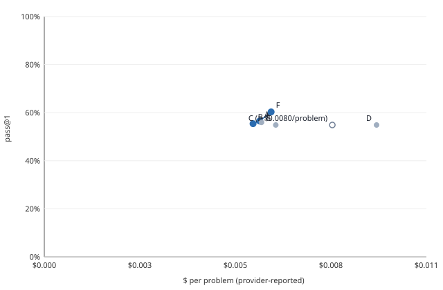

# M3 report: ablations and failure taxonomy

24 October 2026. Agent image from `main` at `d70f534` (M2 merged; no agent change in M3), harness `8e894cf`,
dataset revision `5b807d9`. Tools from PR #5 (`e58e366`) plus one taxonomy rule added with this report. Every
sweep ran in GitHub Actions. The rules from the M1 report still apply: the LLM never produces a score or a label,
and every cost is provider-reported.

**In short** (negative and null findings first):

- **No setting changed the pass rate by a detectable amount.** Six changes to the agent were run 2 times each on all
  92 problems and compared with the base on the same problems. Every 95% interval includes 0. The largest is
  20 turns (F): **+3.8 points [−1.1, +9.2]**, 9 problems better and 5 worse.
- **Turning self-check off costs nothing measurable** (B: −1.1 [−6.0, +4.3]). With self-check on, the agent ran
  its own testbench on only 31–32 of 92 problems. With lint off it ran one on 67, and the pass rate still did not
  move (C: −1.6 [−6.5, +3.3]). Running its testbench more often does not help. Of the failed submissions where
  its testbench had run, the last run passed in 61 of 73: its testbenches check less than the hidden ones.
- **Lint pays for itself in cost, not in passes.** With lint off the agent takes more turns, and a solved problem
  costs ≥ $0.0146 (C) and $0.0169 (D, both off), against $0.0106 for the base: 38–59% more for the same pass rate.
- **The caps are not what limits the agent.** A 5-turn cap stopped 8–11 problems per run on `max_turns` and lost
  nothing detectable (E: −0.5 [−4.9, +4.3]). A $0.02 budget stopped 3–6 per run (G: −1.6 [−7.1, +3.8]).
- **The runner adds no noise of its own.** The base's two runs, both on Arm64, differ by −2.2 [−8.7, +4.3]
  (3 better, 5 worse). That is as wide as M2's Arm64 against x86 (−1.1 [−7.6, +5.4]).
- **Where the failures are** (565 failed problem-runs in 14 runs, labelled from logs and traces):
  - 271 (48%): the hidden tests failed and the agent never ran a testbench of its own;
  - 74 on 8 problems: the hidden build failed on code that compiled for the agent;
  - 73 on 9 problems: the hidden testbench reads a signal, instance or parameter by a name the design does not
    have (a new label);
  - 61: the agent's own testbench passed, but the hidden tests failed;
  - 56 stopped by a cap, 13 simulations that did not finish, 12 submitted after the agent's own testbench failed,
    and 5 with no edit.
- **24 problems failed in all 20 full runs** (M2's 6 and M3's 14). For 10 of them, most failures are one of the
  two interface labels above. For 6 of the 9 problems with missing-signal errors, the name the hidden testbench
  reads is not in the prompt or in any file the agent is given, so no agent can be expected to match it.
- M3's 13 new runs cost **$8.2537** of provider-reported spend, with 1 call unreported.

## Arms and settings

All arms use `openai/gpt-6-luna`, reasoning `default`, the 92 agentic problems, `ubuntu-24.04-arm` and 4 threads,
on M2's image. The base's first run is M2's Arm64 run. The second dispatch of each arm ran before `seed_offset`
existed, so both runs of an arm have seed 1; `ablate.py` keeps runs apart by file.

| Arm | Change from the base | Run 1 | Run 2 |
|---|---|---|---|
| A base | none (10 turns, $0.10 per problem, self-check on, lint on) | 39981444074 (M2) | 40031838020 |
| B | `self_check=false` | 40027264043 | 40033844068 |
| C | `lint=false` | 40027278575 | 40035587883 |
| D | `self_check=false`, `lint=false` | 40037217462 | 40040753269 |
| E | `max_turns=5` | 40042570422 | 40045515591 |
| F | `max_turns=20` | 40046195564 | 40048975297 |
| G | `budget_usd=0.02` | 40049462265 | 40052189876 |

## Paired results

Effect = mean over the 92 problems of (the arm's pass rate − the base's), in points. A problem's rate is its passes
over the arm's 2 runs. The interval is a paired bootstrap over problems; the sign test is exact and two-sided, on
the problems that changed. From [`m3/arms_paired.md`](m3/arms_paired.md):

| Arm | Finding | Effect [95%] | Better / worse / same | Sign test p | Problems | Dropped |
|---|---|---|---|---|---|---|
| C lint off | no detectable effect | −1.6 [−6.5, +3.3] | 9 / 11 / 72 | 0.824 | 92 | 0 |
| D both off | no detectable effect | −1.6 [−6.0, +2.7] | 5 / 9 / 78 | 0.424 | 92 | 0 |
| G budget $0.02 | no detectable effect | −1.6 [−7.1, +3.8] | 7 / 11 / 74 | 0.481 | 92 | 0 |
| B self-check off | no detectable effect | −1.1 [−6.0, +4.3] | 8 / 11 / 73 | 0.648 | 92 | 0 |
| E 5 turns | no detectable effect | −0.5 [−4.9, +4.3] | 5 / 7 / 80 | 0.774 | 92 | 0 |
| F 20 turns | no detectable effect | +3.8 [−1.1, +9.2] | 9 / 5 / 78 | 0.424 | 92 | 0 |

| Arm | Runs: pass rate each | Pooled pass@1 [95% problem bootstrap] | Cost | $/problem | $/solved | Median wall | Tokens |
|---|---|---|---|---|---|---|---|
| A (base) | 57.6%, 55.4% | 104/184 = 56.5% [46.7, 66.3] | $1.1059 | $0.0060 | $0.0106 | 54 s | 5,388,892 |
| B self-check off | 58.7%, 52.2% | 102/184 = 55.4% [45.7, 64.7] | $1.0719 | $0.0058 | $0.0105 | 45 s | 5,424,321 |
| C lint off | 54.3%, 55.4% | 101/184 = 54.9% [46.2, 63.6] | ≥$1.4788 (1 unreported) | ≥$0.0080 | ≥$0.0146 | 60 s | 6,914,086 |
| D both off | 54.3%, 55.4% | 101/184 = 54.9% [45.7, 63.6] | $1.7060 | $0.0093 | $0.0169 | 58 s | 8,297,182 |
| E 5 turns | 57.6%, 54.3% | 103/184 = 56.0% [46.2, 65.8] | $1.1152 | $0.0061 | $0.0108 | 55 s | 5,513,085 |
| F 20 turns | 62.0%, 58.7% | 111/184 = 60.3% [50.5, 69.6] | $1.1649 | $0.0063 | $0.0105 | 59 s | 5,975,170 |
| G budget $0.02 | 54.3%, 55.4% | 101/184 = 54.9% [45.7, 63.6] | $1.1886 | $0.0065 | $0.0118 | 52 s | 5,860,807 |

**The noise floor, measured.** The base's two runs, compared with each other
([`m3/calibration_same_runner.md`](m3/calibration_same_runner.md)): −2.2 [−8.7, +4.3], 3 better, 5 worse, 84 the
same. With 2 runs per arm the arms' intervals are about ±5 points, as PR #5 expected. An effect smaller than
about 5 points on this split needs more runs, or more problems, to show.

**F is the only arm worth a second look.** It is ahead in both runs (62.0% and 58.7%, against 57.6% and 55.4%), at
the same $/solved as the base. But its interval includes 0, and only 6 of its 184 problem-runs used more than 10
turns, of which 1 passed. So the extra turns account for at most 1 of its 7 extra passes; the rest is
run-to-run noise. M3b keeps 10 turns.

### How the agent spent its turns

From the CSVs' `selfcheck_runs` and `turns` columns ([`m3/behaviour.md`](m3/behaviour.md), `tools/behaviour.py`):

| Run | Passed | Ran own testbench | Submitted after 1 turn | Passed, 1 turn | Passed, 2+ turns | Stop reasons |
|---|---|---|---|---|---|---|
| A1 | 53/92 | 31 | 52 | 32/52 | 21/40 | submit 87, wall_time 3, max_turns 2 |
| A2 | 51/92 | 32 | 52 | 33/52 | 18/40 | submit 90, max_turns 2 |
| B1 | 54/92 | 0 | 58 | 38/58 | 16/34 | submit 91, max_turns 1 |
| B2 | 48/92 | 0 | 56 | 33/56 | 15/36 | submit 89, max_turns 3 |
| C1 | 50/92 | 67 | 40 | 22/40 | 28/52 | submit 80, max_turns 11, llm_error 1 |
| C2 | 51/92 | 67 | 32 | 18/32 | 33/60 | submit 82, max_turns 9, wall_time 1 |
| D1 | 50/92 | 0 | 42 | 24/42 | 26/50 | submit 85, max_turns 6, wall_time 1 |
| D2 | 51/92 | 0 | 41 | 21/41 | 30/51 | submit 88, max_turns 4 |
| E1 | 53/92 | 39 | 46 | 30/46 | 23/46 | submit 84, max_turns 8 |
| E2 | 50/92 | 34 | 44 | 28/44 | 22/48 | submit 81, max_turns 11 |
| F1 | 57/92 | 39 | 44 | 31/44 | 26/48 | submit 89, wall_time 2, max_turns 1 |
| F2 | 54/92 | 39 | 51 | 30/51 | 24/41 | submit 91, wall_time 1 |
| G1 | 50/92 | 41 | 44 | 27/44 | 23/48 | submit 84, budget 6, max_turns 2 |
| G2 | 51/92 | 39 | 46 | 27/46 | 24/46 | submit 86, budget 3, max_turns 2, wall_time 1 |

- **The agent submits after one turn on about half the problems**, and those pass more often (62–63% in the base)
  than the ones that take longer (45–53%). Turns follow difficulty: a problem the agent finds hard takes more turns
  and still fails.
- **With lint off, the agent runs its testbench far more** (67 problems against 31–32) and takes more turns. The
  pass rate is unchanged and the cost rises. Why removing lint shifts its checks to the testbench is not
  established here; the agent's prompt lists the checks it may run.
- **E, F and G set the run time and spend, not the result.** E's cap hit 8–11 problems per run with no detectable
  loss; F used more than 10 turns on only 6 problem-runs.

## The Pareto chart

Pass rate (pooled over both runs) against $ per problem (provider-reported). From `ablate.py`, with no external
service:



| Arm | $/problem | Pass rate | Frontier |
|---|---|---|---|
| B self-check off | $0.0058 | 55.4% | yes |
| A base | $0.0060 | 56.5% | yes |
| E 5 turns | $0.0061 | 56.0% |  |
| F 20 turns | $0.0063 | 60.3% | yes |
| G budget $0.02 | $0.0065 | 54.9% |  |
| C lint off | ≥$0.0080 | 54.9% | n/a (cost a lower bound) |
| D both off | $0.0093 | 54.9% |  |

CSV: [`m3/pareto.csv`](m3/pareto.csv). The frontier's three points are within each other's noise on pass rate.
The clear result is on cost: C and D are off the frontier by 33–55% in $/problem.

## The taxonomy

One primary label per failed (problem, run): the first rule that holds, in this order: `llm_error`,
`agent_error`, `killed`, `no_edit`, `stopped_by_cap`, `gave_up`, `sim_incomplete`, `compile_fail_own`,
`compile_fail_hidden`, `signal_missing_hidden`, `tests_failed_selfcheck_passed`, `tests_failed_selfcheck_failed`,
`tests_failed_no_selfcheck`, `harness_error`. Every other rule that holds becomes a secondary flag, as do
`partial_pass`, `single_turn`, `self_check_off`, `lint_off`, `empty_replies`, `best_edit_restored`, `no_log` and
`no_tests`. The rules are in `tools/taxonomy.py`'s docstring. They read three things: the harness's per-test log,
the agent's trace (its last compile and its last own testbench), and its summary (stop reason, files changed).

**New in this report: `signal_missing_hidden`.** The hidden tests built and ran, but a check in the hidden
testbench read a port, internal signal, instance or parameter the design does not have. cocotb reports it as
`AttributeError: <top> contains no child object named <name>`. The agent's own compile cannot see this, because
the names are only in the hidden testbench. Examples from the logs: `dut.state_ff`, `dut.curr_state`,
`dut.poly_branches[0].u_poly_filter.TAPS`, `dut.INDEX_WIDTH`, `dut.enable`. A name read only inside an assert's
f-string message does not count: there the check had already failed, and the message's lookup failed after it.
That happens on 21 failures, on 2 problems (`axis_broadcaster_0001`, `binary_search_tree_algorithms_0014`).

Every M3 CSV in [`m3/runs/`](m3/runs/) was re-collected from its artifact with the new `collect.py`. The old
columns are unchanged (checked field by field), and the evidence columns and `failure_label` are added. So the
counts below come from the committed CSVs alone (`taxonomy.py --arm NAME=csv …`). The excerpts need the artifacts
(`--work`). The full output, with 3 excerpts per label, is [`m3/taxonomy_m3.md`](m3/taxonomy_m3.md).

### By arm

| Label | A1 | A2 | B1 | B2 | C1 | C2 | D1 | D2 | E1 | E2 | F1 | F2 | G1 | G2 | All |
|---|---|---|---|---|---|---|---|---|---|---|---|---|---|---|---|
| no_edit | 1 | 0 | 1 | 2 | 0 | 0 | 0 | 0 | 0 | 1 | 0 | 0 | 0 | 0 | 5 |
| stopped_by_cap | 4 | 2 | 1 | 2 | 8 | 6 | 3 | 3 | 6 | 9 | 3 | 1 | 5 | 3 | 56 |
| sim_incomplete | 1 | 0 | 3 | 0 | 0 | 0 | 2 | 0 | 2 | 0 | 0 | 1 | 3 | 1 | 13 |
| compile_fail_hidden | 5 | 6 | 7 | 5 | 4 | 6 | 5 | 4 | 5 | 5 | 5 | 6 | 5 | 6 | 74 |
| signal_missing_hidden | 7 | 7 | 3 | 5 | 6 | 5 | 5 | 6 | 5 | 5 | 6 | 6 | 3 | 4 | 73 |
| tests_failed_selfcheck_passed | 3 | 6 | 0 | 0 | 11 | 14 | 0 | 0 | 4 | 3 | 5 | 5 | 6 | 4 | 61 |
| tests_failed_selfcheck_failed | 1 | 1 | 0 | 0 | 2 | 2 | 0 | 0 | 0 | 1 | 0 | 1 | 2 | 2 | 12 |
| tests_failed_no_selfcheck | 17 | 19 | 23 | 30 | 11 | 8 | 27 | 28 | 17 | 18 | 16 | 18 | 18 | 21 | 271 |
| **All failures** | 39 | 41 | 38 | 44 | 42 | 41 | 42 | 41 | 39 | 42 | 35 | 38 | 42 | 41 | 565 |

### By cid

| Label | cid003 | cid004 | cid005 | cid016 | All |
|---|---|---|---|---|---|
| no_edit | 0 | 2 | 0 | 3 | 5 |
| stopped_by_cap | 14 | 23 | 11 | 8 | 56 |
| sim_incomplete | 0 | 11 | 1 | 1 | 13 |
| compile_fail_hidden | 45 | 0 | 29 | 0 | 74 |
| signal_missing_hidden | 30 | 11 | 32 | 0 | 73 |
| tests_failed_selfcheck_passed | 13 | 8 | 16 | 24 | 61 |
| tests_failed_selfcheck_failed | 2 | 5 | 1 | 4 | 12 |
| tests_failed_no_selfcheck | 97 | 100 | 47 | 27 | 271 |
| **All failures** | 201 | 160 | 137 | 67 | 565 |

Secondary flags: single_turn 254, lint_off 166, self_check_off 165, tests_failed_selfcheck_failed 33,
tests_failed_no_selfcheck 11, partial_pass 11, signal_missing_hidden 7, empty_replies 4, compile_fail_hidden 4,
sim_incomplete 3, best_edit_restored 2, compile_fail_own 2, tests_failed_selfcheck_passed 1.

- **The two interface labels are problem-bound.** `compile_fail_hidden` falls on 8 problems and
  `signal_missing_hidden` on 9, and each of those problems fails the same way in nearly every run. Neither label
  appears in cid016 (bug fixing on an existing design, whose names are already right).
- **`tests_failed_selfcheck_passed` is spread out**: 61 failures over 26 problems. The agent's testbench checks
  less than the hidden one: it passes on code that the hidden tests fail.
- **No `llm_error`, `agent_error`, `killed` or `harness_error` as a primary label.** The one `llm_error` stop
  (C1) was on a problem that passed with its earlier edit.

### The 28 problems no M2 run solved

M3 solved 4 of them at least once: `jpeg_runlength_enc_0001` (B1, D2), `phase_rotation_0015` (B2), `DES_0001`
(C2) and `lfsr_0005` (F1). The other 24 failed in all 20 full runs. Their labels across M3's 14 runs:

| Problem | cid | Labels across the runs here |
|---|---|---|
| `DES_0001` | cid003 | stopped_by_cap ×7, tests_failed_no_selfcheck ×4, tests_failed_selfcheck_passed ×1, tests_failed_selfcheck_failed ×1 |
| `arithmetic_progression_generator_0001` | cid016 | tests_failed_no_selfcheck ×6, tests_failed_selfcheck_passed ×5, tests_failed_selfcheck_failed ×2, stopped_by_cap ×1 |
| `binary_search_tree_algorithms_0001` | cid004 | tests_failed_no_selfcheck ×13, tests_failed_selfcheck_failed ×1 |
| `binary_search_tree_algorithms_0014` | cid005 | tests_failed_no_selfcheck ×8, stopped_by_cap ×3, tests_failed_selfcheck_passed ×2, compile_fail_hidden ×1 |
| `csr_using_apb_interface_0001` | cid003 | tests_failed_no_selfcheck ×11, tests_failed_selfcheck_passed ×2, signal_missing_hidden ×1 |
| `digital_stopwatch_0001` | cid005 | compile_fail_hidden ×6, signal_missing_hidden ×5, tests_failed_no_selfcheck ×2, stopped_by_cap ×1 |
| `dynamic_equalizer_0001` | cid003 | tests_failed_no_selfcheck ×13, tests_failed_selfcheck_passed ×1 |
| `dynamic_equalizer_0008` | cid005 | tests_failed_no_selfcheck ×7, stopped_by_cap ×3, tests_failed_selfcheck_passed ×2, tests_failed_selfcheck_failed ×1, signal_missing_hidden ×1 |
| `elevator_control_0004` | cid004 | sim_incomplete ×6, tests_failed_no_selfcheck ×4, stopped_by_cap ×4 |
| `hdbn_codec_0001` | cid005 | compile_fail_hidden ×8, tests_failed_no_selfcheck ×6 |
| `jpeg_runlength_enc_0001` | cid005 | tests_failed_no_selfcheck ×8, tests_failed_selfcheck_passed ×3, stopped_by_cap ×1 |
| `lfsr_0005` | cid016 | tests_failed_no_selfcheck ×7, tests_failed_selfcheck_passed ×4, no_edit ×2 |
| `nmea_gps_0008` | cid004 | tests_failed_no_selfcheck ×7, stopped_by_cap ×4, tests_failed_selfcheck_passed ×2, tests_failed_selfcheck_failed ×1 |
| `phase_rotation_0010` | cid005 | signal_missing_hidden ×13, stopped_by_cap ×1 |
| `phase_rotation_0015` | cid004 | tests_failed_no_selfcheck ×10, stopped_by_cap ×3 |
| `phase_rotation_0028` | cid005 | compile_fail_hidden ×14 |
| `phase_rotation_0031` | cid004 | signal_missing_hidden ×11, stopped_by_cap ×2, tests_failed_no_selfcheck ×1 |
| `phase_rotation_0038` | cid003 | signal_missing_hidden ×14 |
| `poly_decimator_0001` | cid005 | signal_missing_hidden ×13, stopped_by_cap ×1 |
| `queue_0001` | cid003 | tests_failed_no_selfcheck ×11, tests_failed_selfcheck_passed ×2, stopped_by_cap ×1 |
| `rc5_0001` | cid003 | tests_failed_no_selfcheck ×5, compile_fail_hidden ×5, tests_failed_selfcheck_passed ×3, tests_failed_selfcheck_failed ×1 |
| `secure_apb_history_shift_register_0001` | cid004 | tests_failed_no_selfcheck ×13, stopped_by_cap ×1 |
| `sigma_delta_audio_0001` | cid003 | compile_fail_hidden ×14 |
| `spi_complex_mult_0002` | cid003 | tests_failed_no_selfcheck ×11, tests_failed_selfcheck_passed ×2, stopped_by_cap ×1 |
| `sync_serial_communication_0001` | cid003 | compile_fail_hidden ×13, stopped_by_cap ×1 |
| `thermostat_secure_0001` | cid004 | tests_failed_no_selfcheck ×12, stopped_by_cap ×2 |
| `traffic_light_controller_0001` | cid004 | tests_failed_no_selfcheck ×12, tests_failed_selfcheck_failed ×1, stopped_by_cap ×1 |
| `ttc_lite_0001` | cid003 | signal_missing_hidden ×12, tests_failed_no_selfcheck ×2 |

### Evidence excerpts

Three per label are in [`m3/taxonomy_m3.md`](m3/taxonomy_m3.md), each at most 10 lines of log and trace,
redacted. Two of them:

**signal_missing_hidden**: `csr_using_apb_interface_0001` (A1). The APB clock is `pclk` in the hidden
testbench and `clk` in the agent's design. Compile, lint and synthesis all pass:
```
log: AttributeError: csr_apb_interface contains no child object named pclk. Did you mean: 'clk'?
log: ======================== 2 failed, 3 warnings in 1.13s =========================
trace: compile exit=0 iverilog -g2012 -o /code/rundir/agent_tb/compile.vvp -I/code/rtl /code/rtl/csr_a
trace: lint exit=0 verilator --lint-only -Wall -Wno-fatal -Wno-MULTITOP --timing -I/code/rtl /code/
trace: synth exit=0 yosys -q -p read_verilog -sv /code/rtl/csr_apb_interface.sv; hierarchy -auto-top
trace: llm reflect decision="submit"
```

**tests_failed_selfcheck_passed**: `axis_broadcaster_0001` (A1). The agent's own testbench passed. The hidden
check on `m_axis_tvalid_1` failed, and its message then named a signal that does not exist (the f-string case
that `signal_missing_hidden` leaves out):
```
log: AttributeError: axis_broadcast contains no child object named m_axis_tvalid. Did you mean: 's_axis_tvali
log: ======================== 1 failed, 3 warnings in 0.56s =========================
trace: testbench_build exit=0 iverilog -g2012 -o /code/rundir/agent_tb/tb.vvp -s tb_axis_broadcast -I/code/rtl
trace: testbench_run exit=0 vvp -n /code/rundir/agent_tb/tb.vvp
trace: llm reflect decision="submit"
```

### Rules against hand labels

Two sets of 15 real failures, labelled by hand from each case's log, trace and summary. The planner wrote both the
labels and the `signal_missing_hidden` rule, so neither set is an independent check of the rules' judgement.
- **Rule-development set** (`taxonomy.py --sheet --sample 15`; [`m3/hand_labels_rule_dev.md`](m3/hand_labels_rule_dev.md)):
  the PR #5 rules agreed on 12 of 15. The 3 misses were all name mismatches that the old rules called
  `tests_failed_no_selfcheck`, and they led to the new label. With it: 15 of 15. Reading these cases also found
  the f-string exception: 2 of the first hand labels were changed after a closer read.
- **Hold-out set** (15 other failures, drawn after the rule was fixed with seed 20261024;
  [`m3/hand_labels_holdout.md`](m3/hand_labels_holdout.md)): **15 of 15 agree**. It holds 8
  `tests_failed_no_selfcheck`, 4 `compile_fail_hidden`, 1 `stopped_by_cap`, 1 `sim_incomplete` and 1
  `tests_failed_selfcheck_passed`, and no `signal_missing_hidden`, so the new rule is checked only on the
  development set.

The fixture set from PR #5 (14 of 15) is unchanged. Its one disagreement, a cap stop whose hidden build failed,
never occurred in the real runs: `compile_fail_hidden` appears as a secondary flag 4 times in 565.

## What the failures say for M3b, M5 and M4

- **M3b: the agent's interface, not its logic, blocks 10 of the 24 problems no run has solved.** Hidden
  testbenches read port names (`pclk`), internal registers (`state_ff`, `curr_state`), instance paths
  (`poly_branches[0].u_poly_filter`) and parameters (`INDEX_WIDTH`).
- **Many of those names are not given to the agent at all.** A word search of each problem's prompt and context
  files (what the agent sees) for the names in `signal_missing_hidden` errors:

  | Problem | Name the hidden testbench reads | In the prompt or context files? | Errors |
  |---|---|---|---|
  | `phase_rotation_0038` | `control_fsm.state_ff` | no | 840 |
  | `phase_rotation_0031` | `detect_sequence.curr_state` | no | 550 |
  | `phase_rotation_0010` | `phase_rotation_viterbi.data_i4_ff` | no | 234 |
  | `poly_decimator_0001` | `poly_decimator.poly_branches` | no | 52 |
  | `direct_map_cache_0001` | `direct_map_cache.INDEX_WIDTH` | yes | 48 |
  | `ttc_lite_0001` | `ttc_counter_lite.enable` | yes (a common word; may not name the signal) | 24 |
  | `digital_stopwatch_0001` | `dig_stopwatch_top.reset`, `.second_pulse`; `.hour` | no; yes for `hour` | 12, 4; 4 |
  | `csr_using_apb_interface_0001` | `csr_apb_interface.pclk` | no | 2 |
  | `dynamic_equalizer_0008` | `equalizer_top.uu_awgn_real`, `.uu_awgn_imag` | no | 1 each |

  (Errors counts every `AttributeError` line over the 14 runs, so a parametrised test counts many times. The search
  is the planner's, over the artifact's `work.problems.jsonl`; it is not a committed tool.) For 6
  of the 9 problems the main name is not in anything the agent can read. Those failures are a property of the
  benchmark items, and no agent change can fix them; M4 should report them separately. Where the name is given
  (`INDEX_WIDTH`, `hour`), an interface check against the specification is the agent change with room to help.
  M3b should do the same search for the 8 `compile_fail_hidden` problems, from the hidden command's `-s` top and
  `-P` parameter names.
- **M3b: self-check needs to check more, not run more often.** Running its testbench on more problems (C) did not
  raise the pass rate, and the last testbench passed in 61 of 73 failed submissions where one ran. A
  cross-problem lessons memory (M3b arms C and D) can be scored on exactly these two labels.
- **M3b design: 2 runs per arm resolves about ±5 points on 92 problems.** The harness-against-memory comparison
  should use 3 runs per arm, or report a smaller effect as not detectable.
- **M5 (verification):** the agent's testbenches are weak. They pass on code the hidden tests fail in 61 failures
  over 26 problems. That is the case for scoring a testbench by mutant kill rate, as M5 plans.
- **M4 (write-up):** report the free split on its own terms. The published leaderboard rows are for full CVDP with
  commercial tools. M3's headline is that none of the agent's settings mattered on this split, and why: the
  failures sit in the interface and in weak self-checks.
  **Correction (2026-10-25).** This is wrong: LBC-bench (https://lbc-bench.si2.org) has three rows on exactly
  these 92 problems of release 1.1.0 (`agentic_code_generation_no_commercial`): 48, 52 and 53 of 92, one run each,
  marked not independently verified ([leaderboards.json at b835413](https://github.com/si2org/lbc-bench.github.io/blob/b8354131ba89f915f5f940a3300a06777ebe1e98/data/leaderboards.json)).
  They land in the same range as the sweeps here (41 to 56 of 92). The story page's "How this compares" section
  sets them side by side with their caveats; the M3b report does too.

## Known gaps

- **The hidden build's own error text is not in the log.** For `compile_fail_hidden`, the log shows the harness's
  `iverilog` command and `CalledProcessError`, not the compiler's message. On `phase_rotation_0028` the hidden
  command passes `-P` overrides of parameters by name, so a missing or renamed parameter is a likely cause, but
  this is not shown for each problem.
- **Whether a name is given to the agent** is a plain word search over the prompt and context files. It cannot
  tell a signal from the same word in prose, and it is not done yet for `compile_fail_hidden`.
- **The new label's rule was developed on the 15 cases it is scored on.** The hold-out set has no case of it.
- **Both runs of each arm have seed 1.** They were dispatched before `seed_offset` existed. The model's sampling
  is not seeded by `CVDP_SEED`, so this changes only the label, not the independence of the runs.
- **The bootstrap and the sign test treat problems as exchangeable.** cid003 (34 problems) weighs most.
- **Self-check pass or fail is read from the trace's truncated tool output**, as in PR #5.
- **No per-cid or AMBA effects are reported.** On 8 AMBA problems, every run passed 3 or 4. Two runs give no
  power on 8 problems.

## Cost bookkeeping

- M3's 13 new runs (the base's first run is M2's): **$8.2537** provider-reported, summed from
  [`m3/runs/`](m3/runs/), with 1 unreported call (C1). The plan's M3 line had no cap of its own beyond $5 per
  sweep (`run_budget_usd`). No run came close: the largest was D at $0.85–0.86 per run.
- Running total for the project: M1 about $0.75, M2 $8.5539, M3 $8.2537.

## Data

| File | What |
|---|---|
| [`m3/runs/`](m3/runs/) | One `results.csv` per run (`<arm><n>_<run id>.csv`), re-collected with the evidence columns and `failure_label` |
| [`m3/arms_paired.md`](m3/arms_paired.md) | `ablate.py` over all arms: paired effects, the Arms table, Pareto |
| [`m3/calibration_same_runner.md`](m3/calibration_same_runner.md) | The base's two runs against each other |
| [`m3/pareto.csv`](m3/pareto.csv), [`m3/pareto.svg`](m3/pareto.svg) | The Pareto points and chart |
| [`m3/behaviour.md`](m3/behaviour.md) | Testbench use, turns and stop reasons per run (`tools/behaviour.py`) |
| [`m3/taxonomy_m3.md`](m3/taxonomy_m3.md) | Labels by arm and cid, the 28 problems, 3 excerpts per label |
| [`m3/hand_labels_rule_dev.csv`](m3/hand_labels_rule_dev.csv), [`m3/hand_labels_holdout.csv`](m3/hand_labels_holdout.csv) | The two hand-labelled sets, with their scores in the `.md` beside each |
| `m3/calibration_same_config.md`, `m3/m2_models_paired.md`, `m3/pareto_m2_models.*`, `m3/taxonomy_m2_csvs.md`, `m3/taxonomy_fixtures.md` | PR #5's worked examples on M2's data and the fixtures |

To regenerate, from the repo root:
```
c(){ ls docs/reports/m3/runs/$1_*.csv; }
python3 tools/ablate.py --base A $(for a in A B C D E F G; do echo --arm $a=$(c ${a}1),$(c ${a}2); done) \
  --pareto-csv docs/reports/m3/pareto.csv --pareto-svg docs/reports/m3/pareto.svg
python3 tools/taxonomy.py $(for r in A1 A2 B1 B2 C1 C2 D1 D2 E1 E2 F1 F2 G1 G2; do echo --arm $r=$(c $r); done)
```
The excerpts and hand-label scores need the run artifacts (`gh run download <id>`, then `--work NAME=<dir>/work`).

## Gotchas

- **A name in an assert's message is not a missing signal.** cocotb evaluates the message after the check fails,
  so an `AttributeError` there hides the real (functional) failure. The rule strips f-strings before it looks.
- **Harness kills record no log path.** `raw_result.json` has `"log": null` and an `error_msg`, but the per-test
  log is still at `reports/<n>.txt` (fixed in PR #5).
- **`final_compiled` describes the last edit, not the one submitted**, when finalize restored an earlier edit
  (fixed in PR #5).
- **Results rows are labelled by model and reasoning only.** The arm is not in the `label` column, so every M3
  command names its arms with `--arm`.

## Decisions

- **Paired, per problem.** A problem's pass rate in an arm is its passes over that arm's runs, so 2 runs give 0,
  ½ or 1. The effect is the mean over problems of the arm's rate minus the base's. The bootstrap resamples
  problems, keeping each problem's runs together.
- **Null results lead.** Arms whose interval includes 0 are listed first, as "no detectable effect"; then the
  worse ones; then the better ones.
- **The sign test is exact and two-sided**, on the problems that changed, with ties dropped.
- **The Pareto frontier counts an arm as dominated** only by one that is at least as good on both axes and
  strictly better on one. Equal points are both on the frontier. An arm with unreported cost has only a lower
  bound on its $/problem, so it is drawn hollow, labelled "≥", kept off the frontier, and never counted as
  dominating another arm.
- **Problems in only one of an arm and the base** are left out of the paired effect and listed under its table.
  The Arms table still pools over all of an arm's problems.
- **One primary label and an explicit precedence**, with the other matching rules kept as flags, so a count adds
  up to the failures and nothing is lost.
- **The evidence goes into `collect.py`**, so each sweep's `results.csv` carries its own labels and the planner
  does not need the artifacts to count them.

## Review round 1

The planner's review of `54604ac` re-ran the tools on four real runs (A1 39981444074, A2 40031838020,
B1 40027264043, C1 40027278575) and asked for 2 must-fix and 6 should-fix changes. All are in; tests went from 112
to 122. No agent change.

| # | Finding | Fix |
|---|---|---|
| 1 | `log: null` harness failures came out `unclassified` | Fall back to `reports/<n>.txt`; with no log at all, `harness_error` (flag `no_log`, the `error_msg` in the excerpt). Fixtures: a kill whose log ends mid-cocotb → `sim_incomplete`; a kill with no log file → `harness_error`. |
| 2 | A restored best edit was labelled `compile_fail_own` | `kept` = `best_compiled…` counts as own compile passed. Fixture: `best_compiled_turn_1`, `final_compiled` false, hidden build failed → `compile_fail_hidden`. |
| 3 | `run_budget_exhausted` and `no_task` had no rule | `stopped_by_cap` and `agent_error`, never `no_edit`. Test. |
| 4 | Empty `tests` and missing logs ended `unclassified` | Both `harness_error` (flags `no_tests`, `no_log`). Fixture for `no_tests`. A test asserts `unclassified` never fires on the fixtures. |
| 5 | Pareto placed unreported-cost arms at their lower bound | Hollow marker and a "≥" label in the SVG; "n/a (cost a lower bound)" in the table, with a footnote; never on the frontier, never dominating. Test. |
| 6 | Problems dropped from the paired effect were not shown | A Dropped column, and a list per arm of the problems only in the arm or only in the base. Test. |
| 7 | A killed session with collected tests and no summary was not `sim_incomplete` | `collected N items` (N ≥ 1) plus no summary → `sim_incomplete`. Test. |
| 8 | The noise floor's wording | "Same settings, different runner (a conservative floor)", with the note that 2 runs per arm on one runner should narrow it. |

## Planner's additions with this report

- **`signal_missing_hidden`**, in `tools/taxonomy.py`, with two fixtures: a real missing handle, and a missing
  handle only in an f-string message, which stays `tests_failed`. It was found by hand-labelling real failures.
- **`tools/behaviour.py`**, for the turns and testbench-use table.
- **The M3 CSVs re-collected** with the evidence columns, so the taxonomy runs from the repo alone.
